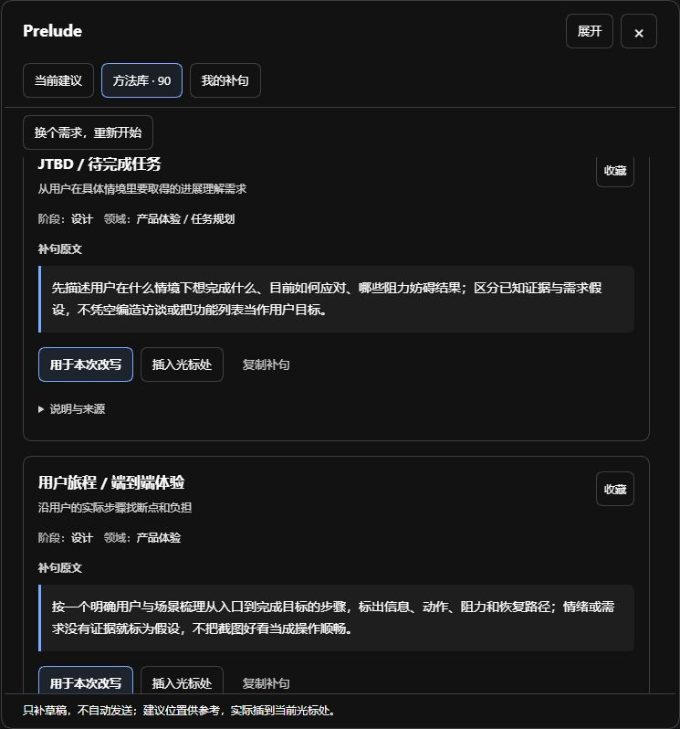

# Prelude

A prompt engineering plugin for the DeepSeek Harness (DSH) chat composer. Find missing requirements, insert one sentence at the cursor, or compare a full rewrite with your original before applying it. You choose what to send.

[Download 0.4.27](https://github.com/dbcaskml183-dotcom/dsh-prelude/releases/download/v0.4.27/dsh-prompt-coach-0.4.27.tgz) · [Installation](docs/installation.en.md) · [简体中文](README.md)

**Start with 90 method cards across task stages and domains, then build your own collection of reusable requirements.**

Find guidance for planning, design, implementation, review, verification, and handoff, across coding, research, writing, data analysis, and other domains. Browse by stage, domain, or keyword. Create, edit, and save your own snippets in **My snippets (我的补句)** for future tasks. The personal library supports import, export, and recovery from its recycle bin.

[Browse the 90 method cards (中文)](docs/catalog.md) · [Machine-readable methods](methods.json) · [Project guide for agents](llms.txt)

## Preview three methods

### Acceptance criteria

Use when a task needs a clear definition of completion.

> Define verifiable completion criteria. At handoff, state the evidence for each criterion and what remains unverified.

[Scenarios and sources](docs/catalog.md#method-acceptance)

### High cohesion, low coupling

Use when unclear module boundaries cause changes to spread across the codebase.

> Organize modules by responsibility, clarify interfaces and dependency direction, and reduce cascading changes. Base the structure on current needs.

[Scenarios and sources](docs/catalog.md#method-cohesion)

### Second-order thinking

Use when a decision may create delayed effects or change later choices.

> Check direct results and subsequent effects, feedback, and delays. Separate evidence from assumptions and focus on consequences that could change the decision.

[Scenarios and sources](docs/catalog.md#method-second-order)

These are English previews of the Chinese cards. The installed method library is primarily in Chinese.

## A rewrite in practice

**Draft:** “Convert CSV to JSON using the Python standard library. Keep the original file.”

**One possible rewrite with the acceptance criteria method:** “Convert CSV to JSON using the Python standard library. Keep the original file. Include a small CSV sample, the expected JSON, and the command I can run to check the result.”

The addition explains how to verify the script while preserving both original constraints.

## Install in DSH

On Linux, WSL2, macOS or native Windows (tested on rc.5), with DSH 0.2.1-rc.2 through rc.5, plus 0.2.2-rc.1 and Node 24+, run this in the host terminal using the `web` profile. Back up an existing profile before adding plugins.

```sh
dsh plugin --profile web add dsh-prompt-coach --ignore-scripts
```

Save drafts, wait for tasks to finish, restart DSH through your usual launcher, and refresh the page. The package retains its earlier name, `dsh-prompt-coach`. [Installation and other environments](docs/installation.en.md)

Desktop App users should install through its plugin manager. The npm CLI manages `web`, not the Electron-managed `desktop` profile.

## Choose the right action

- **Add a sentence** when the draft is clear but lacks one specific requirement. Insert it at the cursor.
- **Rewrite the draft** when several requirements need organizing. Compare and edit the candidate before applying it.
- **Keep the original** when the goal and constraints are already clear. Simple questions can go straight to the conversation.
- **Save a personal snippet** for a format, constraint, or check you use repeatedly.

## Try it in the DSH composer

| What you want | What to do |
| --- | --- |
| Add one specific requirement | Browse the 90 method cards (primarily in Chinese) and insert a snippet at the cursor. |
| Find a gap in your request | Analyze the draft, read the suggested additions, and choose what applies. |
| Bring several requirements together | Select methods, generate a rewrite, and compare it with the original. Edit the candidate before applying it to the composer. You decide when to send. |

Save phrases you use often in your personal library for next time.



Browsing methods is local. Analysis, rewriting, and optional review use the model provider configured in DSH and may incur charges. Conversation excerpts and text attachments are included only when selected.

Native Windows · Node 24 · DSH rc.5: installation, startup, plugin response, and saving favorites verified. Windows desktop clients connected to a WSL2 host have separate testing evidence.

**Tested on Windows desktop** with a Windows launcher or browser connected to DSH 0.2.1-rc.2 in WSL2. Linux and native macOS passed clean-host installation, startup, favorite writes and restart persistence checks on rc.2 through rc.5.

[Compatibility results](docs/installation.en.md#tested-environments) · [Usage (中文)](docs/quickstart.md) · [Report an issue](https://github.com/dbcaskml183-dotcom/dsh-prelude/issues/new/choose) · [MIT License](LICENSE)
