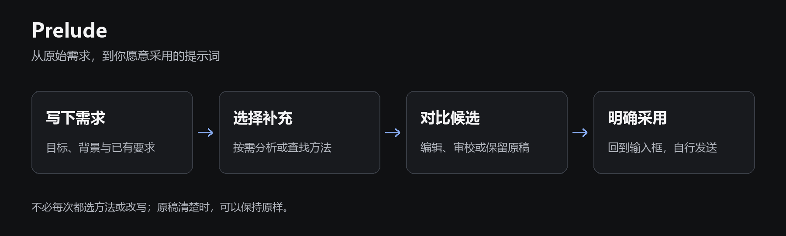

<div align="center">

# Prelude

**在 DSH 里，把需求写清楚。**

看懂方法 · 选择补充 · 对比改写 · 自主采用

[开始使用](#开始使用) · [安装](#安装) · [使用指南](docs/quickstart.md) · [English](README.en.md)

</div>

Prelude 是嵌入 **DeepSeek Harness（DSH）** 输入区的提示词辅助插件。你可以查找专业方法、补充缺少的要求，或让模型生成一份候选稿，再决定如何修改和采用。

不需要先背熟提示词术语，也不用把正在写的需求复制到另一个工具。



*功能流程示意，不是产品截图。*

## 你可以用它做什么

| 想做的事 | Prelude 提供的操作 |
| --- | --- |
| 不知道还需要交代什么 | 分析当前提示词，查看有依据的补充建议；也允许没有建议 |
| 知道术语，但不知道怎么用 | 浏览 **90 张方法卡**：术语标题、人话解释、阶段与领域、可直接使用的补句 |
| 希望把几项要求写成一段 | 自主选用方法，再改写整稿；只推荐、未选中的方法不会自动加入 |
| 担心改写改变原意 | 对照原稿和候选、查看文字差异、手动编辑，按需开启额外审校 |
| 想保留自己常用的写法 | 保存个人补句、收藏方法，在设置中导入、导出和恢复个人库 |
| 想调整使用习惯 | 拖动和缩放面板，选择模型，设置九项内容的默认展开状态 |

本地方法库无需模型。分析、改写和审校使用你在 DSH 中配置的模型，费用由供应商收取。

## 开始使用

1. **先写需求。** 在 DSH 输入框写下目标和已有要求，打开输入区的 **Prelude**。
2. **按需补充。** 可以直接查方法，也可以点击“分析提示词”；挑选适合的方法，选择“用于本次改写”。
3. **对比候选。** 点击“改写整稿”，检查原稿与候选；需要时编辑或审校。
4. **自己决定。** 点击“采用到输入框”后再检查并发送。也可以复制候选，或保留原稿。

**采用不会自动发送。** 采用后未继续编辑、且宿主状态允许时，可以撤回本次替换；有后续编辑时不会直接覆盖新内容。

### 例子：补齐验收要求

原始需求：

```text
写一个 Python 脚本，把 CSV 转成 JSON。
只用标准库，不修改原文件。
```

如果你还想明确“怎样算完成”，可以选用 **验收标准** 方法，并在“补充要求”中手写这条具体要求：

```text
给出一组 CSV 输入和对应的 JSON 输出，并说明如何运行验证。
```

这是人工编写的用法示例，不是模型实测结果。最终要求仍由你选择；不是每个任务都需要更多方法，原稿清楚时可以保持原样。

<!-- prelude-current:start -->
## 安装

当前 **0.4.21 预览版**。使用下方 TGZ 安装包，本项目不通过 npm 分发。

**已验证目标：Linux / WSL2 上的 DSH 0.2.1-rc.2、Node.js 24，现代 Chromium 浏览器。** Windows 浏览器可以连接 WSL 宿主；原生 Windows/macOS 宿主及其他 DSH 版本不在当前支持范围内。

安装包：[dsh-prompt-coach-0.4.21.tgz](release/dsh-prompt-coach-0.4.21.tgz)。公开仓库名是 `dsh-prelude`，内部安装包名保留 `dsh-prompt-coach`，用于兼容原有配置与个人库。不要安装来源未确认的 npm 同名包。

保存现有 profile 配置及插件数据后，在 **运行 DSH 的 Linux / WSL 终端**执行，替换包的实际绝对路径：

```sh
dsh plugin --profile web add /absolute/path/dsh-prompt-coach-0.4.21.tgz --ignore-scripts
dsh --profile web --dump-config
```

正常重新加载同一个 profile，并刷新浏览器。输入框旁和设置中应出现 **Prelude**。登录后 `/api/prompt-coach/v4/status` 应显示 `version: 0.4.21`；未登录返回 401 是正常鉴权行为。

包内已带构建产物，无需运行安装脚本。详细的 [安装、升级与回退](docs/installation.md) 包含 WSL 路径示例与恢复说明。
<!-- prelude-current:end -->

## 模型和资料由你控制

- **模型可选。** 跟随会话模型，或固定使用 DSH 已配置的模型；不要求只能使用 DeepSeek。具体模型适配仍取决于宿主与供应商。
- **资料按需选。** 默认只分析当前草稿；上文或可读取的文本附件需要预览并主动选取，不自动扫描整段聊天、本地目录或第二大脑。
- **额外审校可关闭。** 默认关闭；开启后可能增加一次模型检查，带来额外等待与费用。
- **保留选择权。** 本地检查保护常见路径、禁止条件及要求强度；审校“未发现问题”不是效果保证或正确性认证。

详见 [模型、费用与数据](docs/privacy.md) 和 [常见问题](docs/faq.md)。

## 文档与参与

- [使用指南](docs/quickstart.md)：选方法、改写、采用、撤回、换需求与个人库
- [兼容范围](docs/compatibility.md) · [存储与恢复](docs/operations.md)
- [开发与贡献](CONTRIBUTING.md) · [架构](docs/architecture.md)
- [方法与规范来源](docs/method-sources.md) · [版本记录](CHANGELOG.md)
- [验证范围](VERIFICATION.md) · [安全问题](SECURITY.md)

采用 [MIT License](LICENSE)。Prelude 是独立社区项目，与 DeepSeek 官方无隶属或背书关系。
